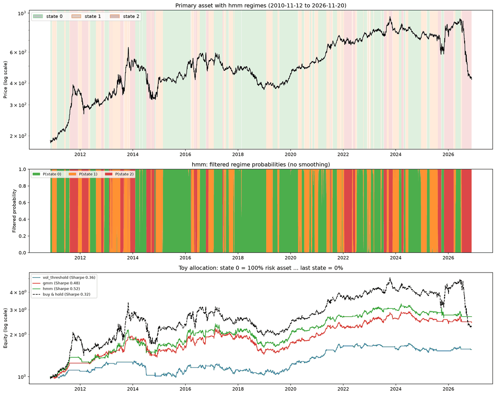

# Market Regime Classification

[](https://pypi.org/project/market-regime-classification/)
[](https://pypi.org/project/market-regime-classification/)
[](LICENSE)
[](https://github.com/sundana/market-regime-classification/actions/workflows/ci.yml)

A causal, walk-forward baseline for **detecting market regimes** with a
volatility rule, a Gaussian mixture, a Gaussian HMM, and a statistical jump
model — plus the evaluation discipline that separates a real signal from a
look-ahead artifact, and a trader-readable regime brief.

This is not a trading system. It is a runnable reference for the three things
regime research usually gets wrong:

- **Filtered inference.** State probabilities at time `t` use only data up to
  `t`; no forward-backward smoothing.
- **Walk-forward evaluation.** Fit on a trailing window, predict the next block
  out-of-sample, refit, repeat.
- **Economic evaluation.** "Regime" has no ground truth, so classification
  accuracy is mostly meaningless. The question is whether regime-conditional
  allocations improve risk-adjusted return at acceptable turnover.

Fitted detectors can be exported to schema-versioned JSON and applied to new
data with the `market-regime-score` CLI, and the economic scorecard can charge
a flat per-rebalance transaction cost.

| | |
|:---|:---|
| Distribution | `market-regime-classification` |
| Import package | `market_regime_classification` |
| CLI command | `market-regime` |
| Python | 3.10+ |

## Demo



*Default synthetic run: HMM regimes shaded on price, causal filtered
probabilities (no smoothing), and walk-forward equity curves for all three
detectors plus buy & hold.*

```text
uv run market-regime --source synthetic --outdir outputs
Data: EQ+1 asset(s), 2007-09-24 -> 2026-11-20 (5000 rows, 4937 feature rows)
Walk-forward: train=756d, refit every 63d, 3 states, features=[...]
Fitting vol_threshold across walk-forward windows ...
Fitting gmm across walk-forward windows ...
Fitting hmm across walk-forward windows ...

=== Economic scorecard (walk-forward, out-of-sample) ===
     detector  n_days   cagr  ann_vol  sharpe  max_drawdown  turnover  switches_per_year  cost_bps  gross_cagr  gross_sharpe  ann_cost
vol_threshold    4180 0.0272   0.0858  0.3554       -0.2373    0.0324            16.2736    0.0000      0.0272        0.3554    0.0000
          gmm    4180 0.0549   0.1288  0.4791       -0.3458    0.0507            20.7338    0.0000      0.0549        0.4791    0.0000
          hmm    4180 0.0612   0.1296  0.5235       -0.3245    0.0169             7.5944    0.0000      0.0612        0.5235    0.0000
     buy_hold    4180 0.0493   0.2298  0.3241       -0.5626    0.0000             0.0000    0.0000      0.0493        0.3241    0.0000
...
Figure: outputs/regimes.png
```

That excerpt is one seeded synthetic run (`--seed 42`), not a performance
claim. On real data the ordering can and does change. The printed table is
truncated here to the headline columns; the CLI also emits `calmar`,
`hit_rate`, and `avg_state`.

## Models

| Name | Type | Notes |
|---|---|---|
| `vol_threshold` | Rule baseline | Trailing-window quantiles of 21-day realized vol. Hard labels, one-hot "probabilities". |
| `gmm` | Unsupervised ML | Gaussian mixture on standardized features; per-sample posterior, no temporal persistence. Not recommended as the primary trader-facing regime model. |
| `hmm` | Unsupervised ML | Full-covariance Gaussian HMM with sticky transition prior, diagonal covariance shrinkage, and quantile-anchored initialization; **forward-filtered only** at prediction time. |
| `jump` | Unsupervised ML | Statistical Jump Model (SJM) with $\ell_1$ state-switch penalty and diagonal-Gaussian emissions; **forward-filtered only** at prediction time. |

All three run through the same walk-forward harness and the same economic
scorecard. If the ML models cannot beat a simple vol-quantile rule
out-of-sample, that is a finding, not a bug. States are ordered by mean
volatility after every refit, so `state_0` is always the calmest regime.

## Contents

- [Demo](#demo)
- [Models](#models)
- [Install](#install)
- [Development setup (uv)](#development-setup-uv)
- [Quick start](#quick-start)
- [CLI options](#cli-options)
- [Outputs](#outputs)
- [Data validation](#data-validation)
- [Engineered features](#engineered-features)
- [Python API](#python-api)
- [Saving and reusing fitted models](#saving-and-reusing-fitted-models)
- [Scoring new data with the CLI](#scoring-new-data-with-the-cli)
- [Regime brief for traders](#regime-brief-for-traders)
- [Regime quality evaluation](#regime-quality-evaluation)
- [Transaction costs and the scorecard](#transaction-costs-and-the-scorecard)
- [Reading the results](#reading-the-results)
- [Deliberate limitations](#deliberate-limitations)
- [The look-ahead trap](#the-look-ahead-trap)
- [Project layout](#project-layout)
- [Testing and contributing](#testing-and-contributing)
- [Publishing to PyPI](#publishing-to-pypi)
- [License](#license)

## Install

Requires Python 3.10 or newer. The `yfinance` data source additionally needs
network access; the default `synthetic` source runs fully offline.

```bash
pip install market-regime-classification
market-regime --help
```

## Development setup (uv)

The project is managed with [uv](https://docs.astral.sh/uv/). `pyproject.toml`
declares dependencies and the `market-regime` console script; `uv.lock` pins
the full resolution.

```bash
# Install uv if needed
curl -LsSf https://astral.sh/uv/install.sh | sh

# Create .venv and install the project plus dev dependencies from uv.lock
uv sync
```

## Quick start

```bash
# No network needed: synthetic market with known latent regimes
# (a couple of minutes for the default 5,000 days, mostly HMM refits)
uv run market-regime --source synthetic --outdir outputs

# Real data via yfinance
uv run market-regime --source yfinance --tickers SPY,TLT \
    --start 2005-01-01 --outdir outputs

# Your own price CSV (date in the first column, then one or more price columns)
uv run market-regime --source csv --csv data/prices.csv \
    --save-models --outdir outputs

# Score new data with a saved model
uv run market-regime-score --model outputs/models/hmm.json \
    --csv data/prices.csv --outdir scores

# Turn a walk-forward run into a trader-readable brief and a quality report
uv run market-regime-brief --run-dir outputs
uv run market-regime-quality --run-dir outputs
```

Add `--cost-bps 5` to charge 5 bps per unit of weight change. `--save-models`
exports the final fitted model per detector to `outputs/models/`.

`uv run market-regime`, `market-regime-score`, `market-regime-brief`, and
`market-regime-quality` invoke the console scripts declared in
`pyproject.toml`:

```toml
[project.scripts]
market-regime = "market_regime_classification.run:main"
market-regime-score = "market_regime_classification.score:main"
market-regime-brief = "market_regime_classification.brief:main"
market-regime-quality = "market_regime_classification.regime_quality:main"
```

`python -m market_regime_classification.run ...` is equivalent. Run the tests
with:

```bash
uv run pytest -q
```

For a non-uv environment, export a plain requirements file:

```bash
uv export --format requirements-txt --no-hashes > requirements.txt
```

## CLI options

| Flag | Default | Description |
|---|---|---|
| `--source {synthetic,yfinance,csv}` | `synthetic` | Data source. `synthetic` needs no network. |
| `--tickers` | `SPY,TLT` | Comma-separated tickers for `--source yfinance`. |
| `--start` | `2005-01-01` | Start date for `yfinance`. |
| `--end` | now | End date for `yfinance`. |
| `--csv` | `data/prices.csv` | Price CSV for `--source csv`. |
| `--n-days` | `5000` | Synthetic history length (minimum 300). |
| `--seed` | `42` | Random seed for synthetic data and model initialization. |
| `--train-days` | `756` | Trailing training window (~3 years). |
| `--refit-every` | `63` | Out-of-sample days between refits (~quarterly). |
| `--n-states` | `3` | Number of regimes; states sorted lowest → highest volatility. |
| `--detectors` | `vol_threshold,gmm,hmm,jump` | Comma-separated detector subset. |
| `--outdir` | `outputs` | Output directory (created if missing). |
| `--cost-bps` | `0` | One-way transaction cost in basis points charged on the absolute weight change at each rebalance. |
| `--save-models` | off | Write the final fitted model per detector to `models/`. |
| `--max-stale-days` | `5` | Maximum consecutive missing price days to forward-fill; longer gaps are an error. |
| `--no-plot` | off | Skip the diagnostic figure. |

## Outputs

```text
outputs/
├── features.csv
├── vol_threshold_probabilities.csv
├── vol_threshold_labels.csv
├── vol_threshold_regime_stats.csv
├── gmm_*.csv
├── hmm_*.csv
├── metrics.csv              # economic scorecard, all detectors + buy & hold
├── metrics.json
├── agreement.csv            # pairwise adjusted Rand index between detectors
├── regimes.png              # price shading, filtered probabilities, equity curves
├── true_states.csv          # synthetic source only
├── models/                  # --save-models only: final fitted model per detector
├── regime_brief.md          # market-regime-brief: plain-language daily note
├── regime_brief.json        # same field set, for dashboards and alerts
├── regime_quality.md        # market-regime-quality: regime-quality report
├── regime_quality.json
└── run_metadata.json        # provenance: versions, git SHA, argv, config, output hashes
```

`metrics.csv` reports `cagr`, `ann_vol`, `sharpe`, `max_drawdown`, `calmar`,
`hit_rate`, `turnover`, `switches_per_year`, `avg_state`, `cost_bps`,
`gross_cagr`, `gross_sharpe`, and `ann_cost` for each detector and for buy &
hold. `*_regime_stats.csv` reports occupancy, run length, and forward 21-day
volatility/return per state.

`run_metadata.json` makes each run auditable and reproducible. It records the
package and Python versions, platform, git revision and dirty flag, the exact
`argv`, the resolved configuration, the data-source parameters, and a SHA-256
digest plus byte size for every other output file (it excludes itself).

## Data validation

The real-data loaders (`--source csv` and `--source yfinance`) reject inputs
that would silently distort the regime features:

- duplicate or missing dates, duplicate columns, and non-numeric prices;
- NaN, infinite, zero, or negative prices;
- a column with no usable observations at all.

History before the first date on which **every** asset has a price is trimmed
rather than back-filled, so a later-listed ticker shortens the sample instead
of inventing history. Interior gaps are forward-filled for at most
`--max-stale-days` consecutive observations (default 5); longer gaps raise an
error naming the affected columns and first date. Set `--max-stale-days 0` to
reject any gap at all. This prevents a stale price from masquerading as zero
volatility.

`--source yfinance` retries transient download failures with exponential
backoff before applying the same validation. The `synthetic` source is
generated in-process and is valid by construction.

## Engineered features

Built from daily prices only, with trailing windows and no look-ahead:

- `rv_5`, `rv_21`, `rv_63` — annualized realized volatility
- `vol_ratio` — `rv_5 / rv_63` (vol acceleration)
- `trend_21`, `trend_63` — log-price momentum
- `drawdown_63` — drawdown from the trailing 63-day high
- `corr_21` — average pairwise correlation (when ≥ 2 assets)

`rv_21` is the reference feature for ordering states and for the rule
baseline's thresholds. The final frame is `dropna`'d, so the first 63 rows are
lost to the warmup for every model equally.

## Python API

Every stage is importable, so the CLI is optional:

```python
from market_regime_classification.config import Config
from market_regime_classification.data import synthetic_market
from market_regime_classification.detectors import GaussianHMMDetector
from market_regime_classification.features import build_features
from market_regime_classification.walkforward import run_walkforward

prices, true_state = synthetic_market(n_days=3000, seed=0)
features = build_features(prices)

cfg = Config(n_states=3, train_days=756, refit_every=63, random_state=0)
cols = cfg.feature_columns(list(features.columns))

result = run_walkforward(
    features,
    lambda: GaussianHMMDetector(n_states=cfg.n_states, random_state=cfg.random_state),
    name="hmm",
    train_days=cfg.train_days,
    refit_every=cfg.refit_every,
    feature_cols=cols,
    vol_col=cfg.vol_col,
)
print(result.labels.tail())
print(result.probs.tail())
```

`result.probs` is indexed by out-of-sample date with one `state_k` column per
regime; `result.labels` is the per-day argmax. `result.final_model` is the last
refitted detector, which can be passed to `save_model`.

## Saving and reusing fitted models

`--save-models` writes the **last refit** of each detector to
`outputs/models/<detector>.json`. The format is schema-versioned JSON, not
pickle, so artifacts are inspectable, diffable, and safe to load:

```bash
uv run market-regime --source csv --csv data/prices.csv \
    --cost-bps 5 --save-models --outdir outputs
```

Each artifact records the detector name, `n_states`, the exact feature and
volatility-column contract, the training-window dates and row count, the
fitted scaler, and the model parameters. It also carries the creating package
version and a UTC timestamp, and is written atomically. Loading validates the
schema version, array shapes, probability normalization, state permutation,
and scaler scale.

Score new observations in Python:

```python
from market_regime_classification.models import load_model

model = load_model("outputs/models/hmm.json")
probs = model.predict(
    new_features,
    feature_cols=model.feature_cols_,
    init_probs=last_filtered_probs,  # optional state carried from the prior block
)
labels = probs.argmax(axis=1)
```

`new_features` must contain the same columns the model was fitted on. A saved
model is a frozen snapshot of one refit; it does not update itself. For
production use, rerun the walk-forward at your refit cadence and reload the
new artifact.

## Scoring new data with the CLI

`market-regime-score` applies a frozen model to new price history without
refitting:

```bash
# Train and export the final refit
uv run market-regime --source csv --csv data/prices.csv \
    --save-models --outdir outputs

# Score a trailing window with the saved HMM
uv run market-regime-score \
    --model outputs/models/hmm.json \
    --csv data/prices.csv \
    --outdir scores
```

Outputs:

```text
scores/
├── scores.csv        # one row per date: state_0..state_k, label
├── features.csv      # the exact feature frame used for scoring
├── last_probs.json   # final filtered vector, for the next scoring block
└── run_metadata.json # argv, model SHA-256, input source, output hashes
```

Pass a trailing price window long enough for the 63-day feature warmup (at
least 80 rows; more if the model uses `rv_63`). Multi-asset models require the
same asset columns, in the same order, as training. The scoring CLI supports
`--source csv` and `--source yfinance`.

For continuous inference, feed the previous final state forward:

```bash
uv run market-regime-score \
    --model outputs/models/hmm.json \
    --csv data/prices.csv \
    --init-probs scores/last_probs.json \
    --outdir scores
```

`--init-probs` accepts a bare JSON list or a `last_probs.json` object. It
continues the HMM forward filter from the prior block; the GMM and volatility
rule ignore it. The CLI never refits: rerun the walk-forward at your refit
cadence and reload the new artifact.

## Regime brief for traders

The scorecard is for research. For a human-readable daily note, run:

```bash
uv run market-regime-brief --run-dir outputs
```

It reads the walk-forward outputs, prints the brief, and writes
`regime_brief.md` and `regime_brief.json` next to them. By default it uses
`jump`, `hmm`, and `vol_threshold` when present; GMM is excluded because it has
no temporal persistence. Use `--detectors jump,hmm` to choose explicitly and
`--primary jump` to set the tie-breaker.

The brief names states in volatility order (CALM → NORMAL → STRESSED), shows
the reference model's confidence and the current run length, flags model
disagreement, and lists the evidence (realised volatility, drawdown, trend,
stock/bond correlation) plus the historical forward volatility and return for
that state. It always states the two things a junior trader needs to hear: this
is a nowcast, not a forecast, and a volatility regime is not a direction call.

```text
# MARKET REGIME BRIEF — SPY,TLT — 2026-11-23

## 🔴 STRESSED — high realised volatility; risk is elevated, not a direction call

State 2 of 3 (calm → stressed).

- Reference model: jump
- Confidence: 100% (model score, not a calibrated probability)
- Stability: FLAPPING — 1 session in this run, 2 switches in the last 20 sessions
- Typical run in this state: 27 sessions

## Model agreement

Agreement: unanimous (3/3 agree).

| Model | Call | P(call) | Current run | Switches/20d |
|---|---|---|---|---|
| jump | 🔴 STRESSED | 100% | 1d | 2 |
| hmm | 🔴 STRESSED | 100% | 3d | 3 |
| vol_threshold | 🔴 STRESSED | 100% | 13d | 2 |

...
```

The JSON is schema-versioned and carries the same fields for a dashboard or an
alerting job. `--stability-min-run`, `--flap-window`, and `--flap-switches`
control when the stability badge drops from STABLE to BUILDING or FLAPPING.

## Regime quality evaluation

The question for this project is not "does it beat buy & hold?" but "is the
regime call accurate, timely, stable, and calibrated?" Run:

```bash
uv run market-regime-quality --run-dir outputs

# optional: compute calibration from raw returns
uv run market-regime-quality --run-dir outputs --prices-csv data/prices.csv
```

It writes `regime_quality.json` and `regime_quality.md` and prints a report
covering:

- **Recovery** on synthetic runs with `true_states.csv`: exact and within-one
  accuracy, adjusted Rand index, transition detection lag, and churn versus the
  latent state.
- **Separation**: forward 21-day volatility and return by state, plus the
  high-volatility / calm ratio.
- **Calibration**: AUC, Brier score, Spearman correlation, and a reliability
  table against top-tercile forward volatility (when `--prices-csv` is given).
- **Stability**: switches per year, run lengths, share of runs under five days,
  and refit-boundary churn.
- **Consensus**: all-agree share and pairwise agreement.
- **Stress-event recall**: whether the highest-volatility state appears within
  ±21 calendar days of a configurable event list.

`uv run pytest -q` includes deterministic tests for these metrics (perfect
recovery, lag detection, strict-majority consensus, calibration ranking,
refit-day churn, and event recall), so the evaluation gate runs in CI.

## Transaction costs and the scorecard

The economic scorecard charges a flat one-way cost on the absolute weight
change at each rebalance:

```bash
uv run market-regime --source csv --csv data/prices.csv --cost-bps 5
```

`--cost-bps` is in basis points (5 = 0.05%). You can fold commissions and
average slippage into the same number. The opening position at the first
out-of-sample date is not charged, so the strategy and buy & hold follow the
same convention. Headline `cagr`, `sharpe`, `max_drawdown`, and `calmar` are
**net** of costs; `gross_cagr` and `gross_sharpe` repeat the same metrics
before costs; `ann_cost` is the annualized cost drag as a fraction of the
portfolio. Buy & hold has no rebalancing cost (`ann_cost = 0`).

The model still ignores market impact, borrow/financing costs, taxes, and cash
yield, and the allocation rule remains a diagnostic, not a strategy.

## Reading the results

- **`share` / `avg_run_days`** — a regime that flips every few days is not a
  regime. Real volatility regimes persist for weeks to months.
- **`fwd_vol_21d` / `fwd_ret_21d`** — forward 21-day realized volatility and
  return by regime. Good separation here is the main evidence the detector
  found something.
- **Sharpe / MaxDD / turnover** — the toy allocator maps state 0 → 100%
  equity, middle states linearly, last state → 0%. `--cost-bps` charges a flat
  cost on the absolute weight change; `gross_sharpe` shows the before-cost
  figure and `ann_cost` the annualized drag. Market impact, financing, taxes,
  and cash yield are still ignored; treat it as a diagnostic, not a strategy.
- **ARI between detectors** — how much the models agree. Very high agreement
  with little economic difference means the HMM is not earning its complexity.

On the synthetic sample, ARI against the *latent* state is typically only
~0.1–0.3 even when forward-vol separation is strong. That is expected: every
feature is a trailing window, so detection necessarily lags each switch, and
ARI penalizes every lagged day. The informative diagnostics are
regime-conditional forward volatility/return and the economic scorecard.

## Deliberate limitations

This is a research baseline, not a production trading system:

- The regime brief is a nowcast. Transitions are typically identified 6–12
  trading sessions late on the synthetic benchmark, and a high-volatility state
  is not a directional sell signal. Check calibration with
  `market-regime-quality` before showing the brief to traders.
- Single asset target; multi-asset regime work needs covariance/correlation
  state modeling.
- Costs are a flat bps charge on the absolute weight change; there is no
  market-impact model, borrow/financing cost, tax, or cash yield.
- No hyperparameter search. `n_states`, `train_days`, and `refit_every` are
  fixed by CLI flags; choosing them on the test period would be data snooping.
- The HMM is full-covariance with light regularization. It can still find
  local optima; `n_init` restarts mitigate but do not eliminate this.
- The synthetic generator is a sanity check, not evidence about real markets.
- Saved models are snapshots of one refit with no online updating; you own the
  refit cadence and monitoring.

## The look-ahead trap

An HMM fitted on the full sample and queried with `predict_proba` returns
**smoothed** state probabilities. At time `t` they incorporate observations
after `t`. Plots look excellent; live results do not.

`market_regime_classification.detectors` runs its own forward recursion and
only ever consumes data up to `t`. The HMM's EM uses forward-backward on the
training window only, which is legitimate because that window is entirely in
the past. `tests/test_detectors.py` and `tests/test_walkforward.py` verify that
truncating future rows leaves past probabilities unchanged.

## Project layout

```text
pyproject.toml       # metadata, deps, console script, pytest/uv config
uv.lock              # pinned dependency resolution (commit this)
.python-version      # interpreter uv should use
LICENSE              # MIT
MANIFEST.in          # files included in the sdist
.github/workflows/
├── ci.yml           # lint, type-check, and tests on Python 3.10-3.13
└── publish.yml      # lint, type-check, tests, build, PyPI trusted publishing
market_regime_classification/
├── config.py        # CLI/config defaults
├── data.py          # synthetic generator, validated yfinance/CSV loaders
├── features.py      # feature engineering
├── detectors.py     # vol-threshold, GMM, causal Gaussian HMM
├── walkforward.py   # rolling refit / out-of-sample harness
├── evaluate.py      # regime stats + cost-aware economic scorecard
├── metadata.py      # run provenance (versions, git SHA, config, hashes)
├── models.py        # schema-versioned JSON save/load for fitted detectors
├── plotting.py      # diagnostic figure
├── run.py           # end-to-end training/evaluation CLI
├── score.py         # inference CLI for saved models
├── regime_labels.py # state names, colours, plain-language descriptions
├── brief.py         # trader-readable regime brief CLI
└── regime_quality.py# regime-quality metrics + evaluation CLI
tests/
├── test_package.py  # metadata + console-script registration
├── test_features.py
├── test_detectors.py
├── test_walkforward.py
├── test_data.py     # loader validation and gap handling
├── test_metadata.py # provenance record + output hashing
├── test_models.py   # model round-trip and payload validation
├── test_score.py    # scoring CLI and state carry-forward
├── test_regime_quality.py # recovery, stability, calibration, consensus
├── test_brief.py    # trader brief, consensus, disagreement, JSON schema
└── test_cli.py      # end-to-end CLI including costs, models, metadata
```

## Testing and contributing

Bug reports, feature requests, and pull requests are welcome at
[github.com/sundana/market-regime-classification](https://github.com/sundana/market-regime-classification).

Before opening a pull request:

1. Fork the repo and create a branch from `main`.
2. Run `uv sync`, make your change, and add or update tests.
3. Run the full gate: `uv run ruff check .`, `uv run mypy`, and
   `uv run pytest -q`.
4. Keep changes focused and explain *why* in the PR description, especially
   for anything that affects evaluation or could introduce look-ahead.

CI runs lint and type-check once and the test suite on Python 3.10-3.13 for
every push to `main` and every pull request. The publish workflow runs the same
gate before uploading a release.

The suite covers feature causality, walk-forward structure, HMM filtering
continuity, scorecard math (including cost accounting), package/console-script
registration, loader validation (duplicate dates, non-positive prices, bounded
gap filling), run metadata/output hashing, model save/load round trips and
payload validation, the scoring CLI (including state carry-forward), the
end-to-end training CLI, regime-quality metrics (recovery, transition lag,
strict-majority consensus, calibration ranking, refit-day churn, event recall),
and the trader brief (consensus, disagreement, stability, and JSON schema).

To add a detector, implement the `BaseDetector` interface (including
`_params_dict` and `from_dict`) in
`market_regime_classification/detectors.py`, register it in `make_detector()`
and `models.py`, and add a causality test showing that truncating future rows
does not change past labels or probabilities.

## Publishing to PyPI

Build and validate locally:

```bash
uv build
uvx twine check dist/*
```

Publish with an API token:

```bash
UV_PUBLISH_TOKEN=pypi-... uv publish
```

Or use `.github/workflows/publish.yml` with PyPI
[Trusted Publishing](https://docs.pypi.org/trusted-publishers/). The workflow
runs on `v*` tags, published GitHub releases, or manual dispatch; it installs
locked dependencies, runs lint, type-check, and the tests, builds, runs
`twine check`, and uploads via OIDC — no long-lived token in the repository.
Configure the PyPI project to trust this repository and the `publish` workflow
before tagging a release.

## License

MIT. See [LICENSE](LICENSE).
